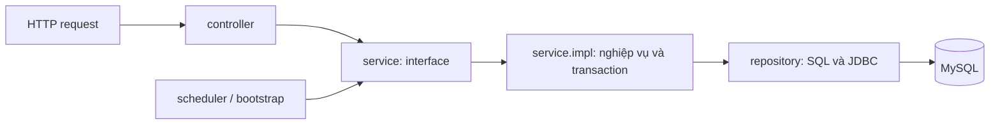

# Cấu trúc backend theo tầng

Backend được sắp xếp lại thành **Controller → Service interface → ServiceImpl → Repository → MySQL**. API, request/response nghiệp vụ, schema, tên bảng và luồng frontend được giữ nguyên.



## Thư mục

```text
backend/src/main/java/vn/mta/shop/
├── ShopApplication.java
├── controller/          # HTTP endpoints, validation DTO, principal, response
├── dto/                 # Request records, không đặt trong controller/service nữa
├── service/             # Chỉ các interface nghiệp vụ
│   ├── ShopService.java
│   ├── AdminService.java
│   ├── AuthService.java
│   ├── AccountService.java
│   ├── OrderService.java
│   ├── PaymentService.java
│   ├── ManagementService.java
│   ├── BackgroundService.java
│   ├── BootstrapService.java
│   ├── ReadCacheService.java
│   └── impl/            # Implementation tương ứng, có @Service
├── repository/          # @Repository, JdbcTemplate, SQL và bind tham số
├── model/               # Kiểu nghiệp vụ dùng chung, ví dụ QuotaCounter
├── cache/               # Vùng cache công khai và sự kiện xóa cache sau commit
├── security/            # SecurityFilterChain, principal, adapter session/CSRF
├── scheduler/           # @Scheduled chỉ gọi BackgroundService
├── bootstrap/           # ApplicationRunner chỉ gọi BootstrapService
├── config/              # Cấu hình JSON/UTC
├── common/              # BusinessException và chuẩn hóa email
└── exception/           # ApiErrors chuyển lỗi thành HTTP response
```

## Trách nhiệm cụ thể

| Tầng | Làm gì | Không làm gì |
|---|---|---|
| Controller | Khai báo URL/method, đọc DTO/principal/header, gọi service interface, trả response | Không SQL, không inject repository/ServiceImpl, không quản lý transaction nghiệp vụ |
| Service interface | Khai báo hợp đồng các use case | Không chứa SQL hay implementation |
| ServiceImpl | Kiểm tra nghiệp vụ, điều phối service/repository, tính giá/quota/trạng thái, đặt transaction | Không khai báo API, không lấy request/response HTTP để xử lý nghiệp vụ |
| Repository | Thực thi câu SQL, bind tham số typed, lấy projection và thực hiện khóa hàng | Không quyết định quyền, giá sale được áp dụng, chuyển trạng thái nghiệp vụ hay tự mở transaction cho từng câu SQL |
| DTO | Mô tả dữ liệu request và các constraint validation | Không truy cập database |

Các repository là **class JDBC có @Repository**, không phải interface Spring Data JPA: dự án đang dùng JdbcTemplate. Mỗi repository có phương thức nghiệp vụ cụ thể như `reserve`, `findForUpdate`, `findByEmail`, không công khai một hàm nhận SQL tùy ý từ service.

### Application service và nghiệp vụ

- **ShopServiceImpl**: điều phối các use case của khách hàng, hiển thị giá sale và hồ sơ.
- **AdminServiceImpl**: điều phối API quản trị, tìm kiếm/phân trang và ghép dữ liệu trả về.
- **AuthServiceImpl**: xác thực, đăng ký, yêu cầu xóa tài khoản.
- **AccountServiceImpl**: đọc danh tính/trạng thái/quyền; triển khai UserDetailsService qua AccountService để Spring Security dùng.
- **OrderServiceImpl**: tạo/hủy đơn, giữ/trả tồn và quota, xuất kho, chuyển trạng thái.
- **PaymentServiceImpl**: sandbox, chữ ký webhook, chống trùng, thanh toán đến muộn và hoàn tiền.
- **ManagementServiceImpl**: quy tắc quản lý sản phẩm/tài khoản/khách hàng/chiến dịch, bảo vệ admin cuối cùng và audit.
- **BackgroundServiceImpl**: xử lý batch hết hạn và phát Kafka outbox.
- **BootstrapServiceImpl**: tạo tài khoản demo khi chưa tồn tại.

Các application service gọi interface của service nghiệp vụ. Ví dụ ShopServiceImpl gọi OrderService, không khởi tạo hoặc inject trực tiếp OrderServiceImpl.

### Repository theo nhóm dữ liệu

`AccountRepository`, `CustomerRepository`, `ProductRepository`, `InventoryRepository`, `CampaignRepository`, `OrderRepository`, `PaymentRepository`, `RefundRepository`, `AuditRepository`, `OutboxRepository`, `IdentityRepository`, `SystemRepository`.

InventoryRepository xử lý cả reservation; CampaignRepository xử lý item/quota chiến dịch; OrderRepository xử lý order/order_items. Các repository trả projection Map như phiên bản cũ để giữ ổn định dữ liệu API; việc tách tầng không chuyển dự án sang JPA hay thay đổi schema.

## Ví dụ luồng tạo đơn

```text
POST /api/orders
  → ShopController.place()                 nhận DTO + Idempotency-Key + principal
  → ShopService.place()                   interface
  → ShopServiceImpl.place()               xác định customer từ tài khoản
  → OrderService.place()                  interface
  → OrderServiceImpl.place()              @Transactional
      → CustomerRepository.lockActiveById()
      → OrderRepository.findByIdempotencyKey()
      → InventoryRepository.reserve()
      → CampaignRepository.reserveItem()/reserveCustomerQuota()
      → OrderRepository.insert()/insertItem()
      → InventoryRepository.insertReservation()
      → OutboxRepository.insertOrderEvent()
```

Ví dụ Controller chỉ còn:

```java
@PostMapping("/orders")
public Map<String, Object> place(
    @RequestHeader("Idempotency-Key") String key,
    @Valid @RequestBody PlaceOrderRequest input,
    Principal principal) throws Exception {
  return service.place(key, input, principal.getName());
}
```

Repository giữ UPDATE có điều kiện để chống vượt tồn. ServiceImpl đọc số dòng cập nhật: không giữ được hàng thì báo lỗi nghiệp vụ và rollback toàn bộ transaction.

## Transaction và khóa hàng

- `@Transactional` nằm ở **ServiceImpl**, không nằm ở controller/scheduler/repository.
- Transaction bao trùm nhiều repository dùng chung DataSource: trả về khỏi một hàm repository không đồng nghĩa đã commit. Khóa `FOR UPDATE` vẫn giữ đến khi use case kết thúc.
- `IdentityRepository.lastInsertedId()` dùng kết nối đã được Spring gắn với transaction, giữ đúng ID của lần insert trước đó dù có nhiều request đồng thời.
- Các hàm nội bộ vòng đời đơn như `lock`, `release`, `paid`, `expireLocked`, `event`, `cancelPendingCustomer` yêu cầu transaction hiện có bằng `Propagation.MANDATORY` khi gọi qua Spring proxy.
- Chi tiết đơn quản trị trước đây có transaction ở controller; nay transaction nằm ở OrderServiceImpl.detail.
- Scheduler gọi BackgroundService qua interface để Spring mở transaction cho batch hết hạn.
- Sandbox complete có transaction ngoài bao trùm việc ký và xử lý callback. Không chỉ dựa vào @Transactional của hàm webhook khi gọi nội bộ cùng class, vì self-invocation không đi qua proxy Spring.
- Quy tắc rollback/khóa/SQL giữ nguyên nghiệp vụ đang chạy; các kiểm thử tranh mua, worker hết hạn và hoàn tiền đã được chạy lại.

## Security và lỗi HTTP

AuthController chuyển thông tin đăng nhập cho AuthService. Sau xác thực, **SessionManager** chỉ xử lý adapter HTTP: đổi session ID, lưu security context, đổi CSRF token hoặc hủy session. Đây là trách nhiệm giao tiếp HTTP, không chứa SQL hay quy tắc giá/kho/tài khoản.

AccountPrincipal được tách khỏi AccountService, giữ session_version/quyền cho SecurityConfig kiểm tra. BusinessException không phụ thuộc Controller hoặc Spring MVC; ApiErrors ở package exception chuyển lỗi nghiệp vụ thành response HTTP với mã/trường lỗi tương ứng.

## Kiểm tra kiến trúc và hồi quy

```bash
cd backend
mvn test
```

`LayerArchitectureTest` có 5 kiểm tra:

1. Controller chỉ inject service interface hoặc adapter session HTTP.
2. Mỗi service contract là interface và có ServiceImpl được đánh dấu @Service.
3. JDBC và SQL chỉ xuất hiện trong repository; repository không phụ thuộc service/controller.
4. Use case ghi dữ liệu/chi tiết khóa hàng có transaction ở ServiceImpl; sandbox complete có rollback cho Exception.
5. Scheduler/bootstrap không chứa repository, transaction hoặc xử lý mật khẩu.

Chạy hồi quy từ thư mục repo như trước: `py scripts/auth-smoke.py`, `py scripts/smoke.py`, `py scripts/commerce-smoke.py`, các kiểm tra trình duyệt và kiểm tra nâng cao trong commerce.md. Không cần migration hoặc xóa volume cho lần sắp xếp code này.

## Cache đọc có fallback

ReadCacheService/ReadCacheServiceImpl tách xử lý cache khỏi ShopServiceImpl; RedisCacheRepository là adapter Redis bổ sung. Khi cache lỗi chỉ gọi supplier đọc MySQL, không chuyển quyết định tồn kho/thanh toán sang Redis. Xóa cache dùng sự kiện sau commit; xem `cache-fallback.md`.
