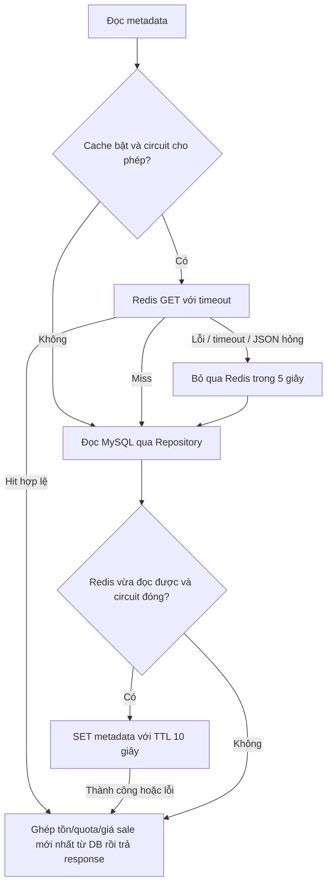

# Redis cache với fallback về MySQL

## Phạm vi

`GET /api/products` cache metadata công khai: id, tên, thương hiệu, mô tả, biến thể và giá cơ bản. Tồn khả dụng và giá/quota sale hiện tại vẫn đọc MySQL trên mỗi request.

`GET /api/campaigns` cache tên/lịch/trạng thái chiến dịch; item, tồn, quota đọc lại MySQL. Thời gian server được tạo mới và chiến dịch hết hạn được lọc lại ở mỗi response, không dùng đồng hồ trong cache.

Không cache quyền, tài khoản, session, đơn hàng, số tiền thanh toán, quyết định giữ kho hoặc quota. Các nghiệp vụ ghi vẫn dùng transaction và các điều kiện/khóa database như trước.

## Luồng fallback



- Lỗi Redis GET không làm API trả lỗi nếu MySQL vẫn đọc được.
- SET cache thất bại không làm mất kết quả MySQL vừa đọc. Không cố ghi cache ngay sau GET đã lỗi, tránh chờ timeout lần hai.
- JSON cache sai phiên bản/shape hoặc thời gian không hợp lệ cũng fallback.
- Khi lỗi, circuit của API instance tạm bỏ qua Redis 5 giây. Sau đó chỉ một request thăm dò; request khác đọc DB. Đọc Redis thành công đóng circuit và tự dùng cache trở lại.
- Ngoại lệ database nằm ngoài catch Redis: nếu MySQL cũng lỗi, API vẫn trả lỗi thật. Đây không phải failover database hoặc cam kết API hoạt động khi cả Redis và MySQL cùng hỏng.
- Log cảnh báo của fallback không in payload/secret và chỉ phát khi mở lại khoảng nghỉ sau lỗi. Lettuce có thể có log kết nối riêng.

## Xóa cache sau thay đổi quản trị

ManagementServiceImpl phát PublicCatalogChanged trong transaction khi sửa sản phẩm hoặc chiến dịch. CacheInvalidationListener dùng AFTER_COMMIT, nên transaction rollback không kích hoạt xóa cache.

Lỗi DEL sau commit bị cô lập, không biến thao tác lưu DB thành lỗi với người dùng. API instance ghi nhận cần xóa lại hai key; lần thăm dò Redis tiếp theo sẽ thử xóa trước khi đọc, tránh dùng lại metadata cũ sau outage.

Metadata là cache-aside có tính nhất quán cuối cùng: vẫn có cửa sổ stale tối đa theo TTL, ví dụ một request đang nạp cache đồng thời với chỉnh sửa hoặc nhiều API instance. Giá/stock/quota dùng ra quyết định đặt hàng luôn được kiểm tra ở DB; giá client đã xác nhận khác giá hiện tại sẽ bị từ chối để xác nhận lại. Không coi cache là nguồn dữ liệu chính thức.

## Cấu hình

| Biến môi trường | Mặc định | Ý nghĩa |
|---|---|---|
| CATALOG_CACHE_ENABLED | true | false: bỏ qua hoàn toàn đọc/ghi cache tại service |
| CATALOG_CACHE_TTL | 10s | TTL metadata, phải dương và không vượt 5 phút |
| CATALOG_CACHE_FAILURE_BACKOFF | 5s | Khoảng nghỉ khi lỗi, dương và không vượt 1 phút |
| REDIS_COMMAND_TIMEOUT | 200ms | Timeout lệnh Redis |
| REDIS_CONNECT_TIMEOUT | 200ms | Timeout kết nối socket Redis |

Có thể đặt các giá trị này trong `.env` dùng cho Compose rồi tạo lại API. Timeout là cho kết nối/lệnh Redis, không phải SLA tổng của HTTP (còn initialization, network và thời gian MySQL).

Lettuce giới hạn request queue 64 và từ chối lệnh khi disconnected để không xếp hàng lệnh cache vô hạn. Connect timeout vẫn được truyền vào SocketOptions khi custom ClientOptions. Không có retry vòng lặp Redis trong mỗi request.

Hai key ứng dụng:

```text
mta:public:products-metadata:v1
mta:public:campaigns-metadata:v1
```

Giá trị JSON có schema version, không dùng Java serialization hoặc bật polymorphic typing từ dữ liệu cache. Không dùng FLUSHALL để xóa cache của ứng dụng.

## Các file xử lý

- `service/ReadCacheService.java`: interface cache-aside.
- `service/impl/ReadCacheServiceImpl.java`: hit/miss/fallback, TTL, circuit và xử lý lỗi cache.
- `repository/RedisCacheRepository.java`: GET/SET/DEL bằng StringRedisTemplate, không chứa fallback database.
- `service/impl/ShopServiceImpl.java`: đọc metadata qua cache, bổ sung dữ liệu động từ repository MySQL.
- `cache/CacheInvalidationListener.java`: xóa cache sau commit.
- `config/RedisClientConfig.java`: queue và timeout/reconnect của Lettuce.

Cấu trúc Controller → Service interface → ServiceImpl → Repository được giữ nguyên. Không thay đổi frontend, API hoặc schema; không cần migration/reset database.

## Chạy và kiểm thử trên Windows

```powershell
git pull origin master
docker compose up -d --build
py scripts/check-ready.py
py scripts/cache-fallback-smoke.py
```

Kiểm tra outage trong môi trường **phát triển**:

```powershell
py scripts/cache-fallback-smoke.py --outages
```

Script dùng Docker CLI, tạo sản phẩm thử riêng, kiểm tra hit/TTL, tồn kho mới dù cache hit, đổi metadata sau commit, dữ liệu cache hỏng. Với --outages, script tạm stop Redis rồi start lại; sau đó dùng CLIENT PAUSE 3000 ALL để tạo command timeout thật (không cần Docker pause/cgroup). Các bước khởi động/CLIENT UNPAUSE nằm trong finally. Không chạy outage test trên dịch vụ production có người dùng.

Script chỉ thao tác hai key public và sản phẩm thử của nó; không xóa volume hoặc FLUSHALL. Giữ mặc định TTL/backoff khi chạy script để phù hợp thời gian chờ kiểm thử. API cần tài khoản demo; nếu đổi mật khẩu thì dùng MTA_ADMIN_PASSWORD/MTA_USER_PASSWORD cho script.

`mvn test/package` chạy các unit test về hit/miss, lỗi kết nối, command timeout, lỗi ghi/xóa cache, dữ liệu hỏng, không che lỗi MySQL, cache disabled, một half-open probe và phục hồi. ShopCacheBoundaryTest bảo đảm metadata dùng chung không bị sửa và không đóng băng tồn kho/giá sale/quota/thời gian.

## Đọc comment trong source theo thứ tự nào?

1. `CacheRegion.java`: xác định hai vùng metadata công khai và giới hạn payload.
2. `ReadCacheService.java`: hợp đồng `getOrLoad`; Supplier là hàm đọc DB chưa chạy.
3. `ReadCacheServiceImpl.java`: theo comment Bước 1–5 để hiểu CLOSED/OPEN/HALF-OPEN, hit/miss/fallback và SET sau khi đọc DB. Các cờ `retryAt`, `probe`, `dirty` được giải thích tại chỗ.
4. `RedisClientConfig.java` và `application.yml`: phân biệt connect timeout, command timeout, TTL và backoff; chúng không có cùng ý nghĩa.
5. `ShopServiceImpl.java`: metadata đi qua cache, nhưng stock/quota/giá sale vẫn lấy DB; Map được sao chép trước khi thêm dữ liệu động.
6. `ManagementServiceImpl.audit()` → `PublicCatalogChanged` → `CacheInvalidationListener`: vì sao chỉ xóa cache sau commit và không làm lỗi thao tác lưu khi Redis hỏng.
7. Hai lớp test cache và `scripts/cache-fallback-smoke.py`: mỗi tình huống kiểm thử có comment nêu điều cần bảo đảm.

Lưu ý `Payload.schema` là phiên bản định dạng JSON cache, không phải optimistic-lock version hay session_version của tài khoản.
